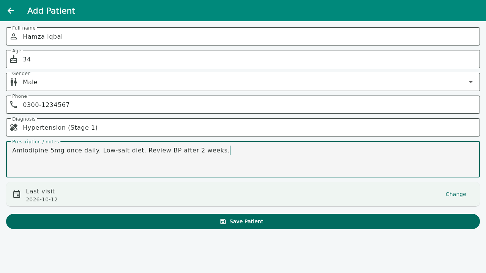
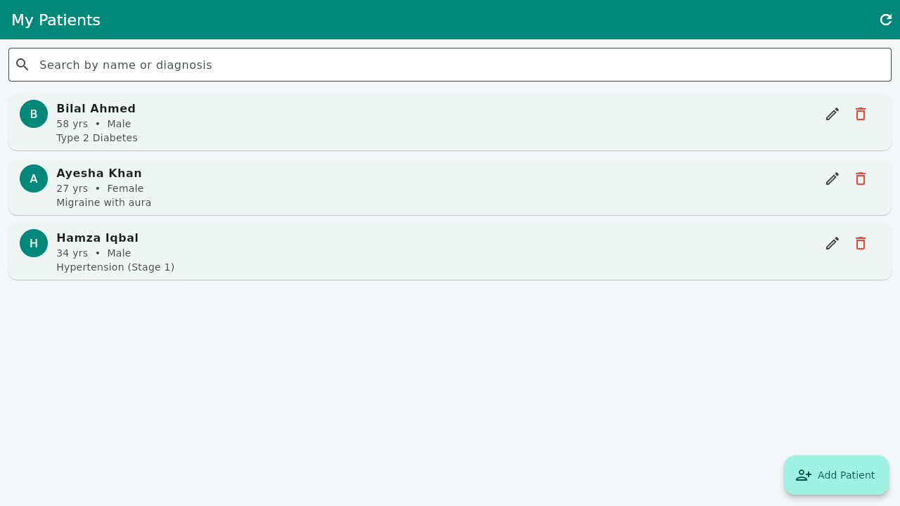
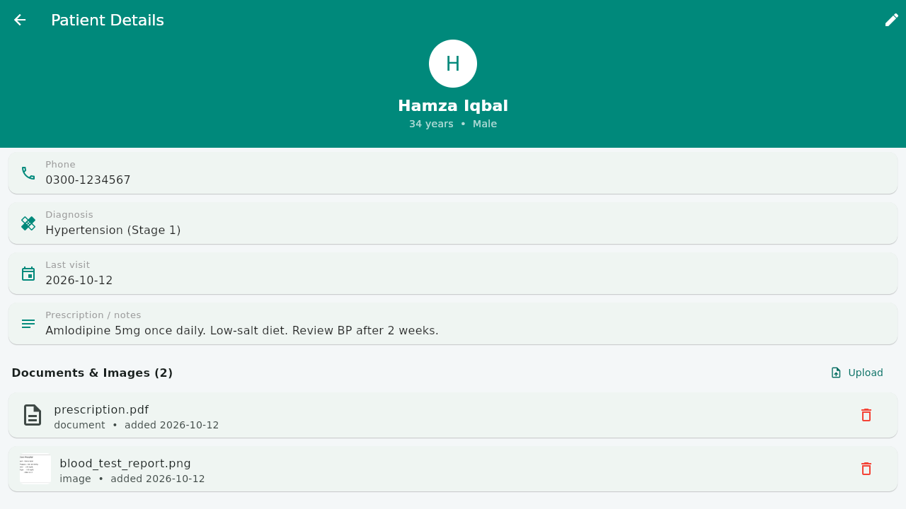
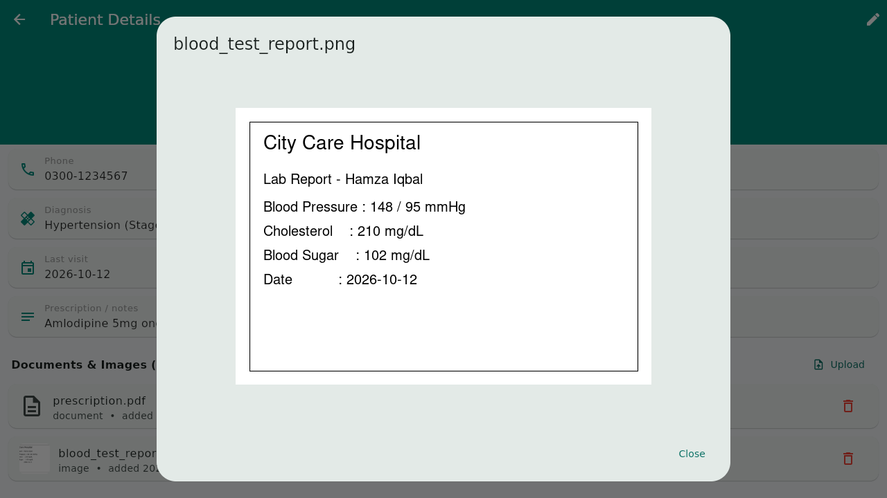
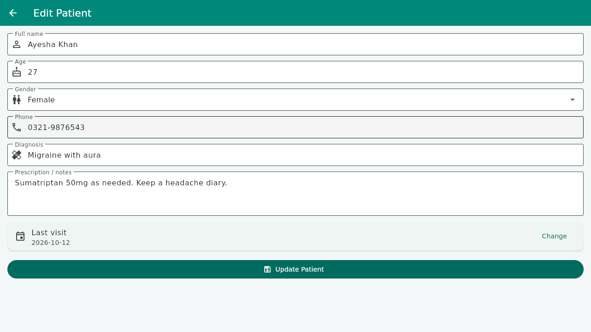
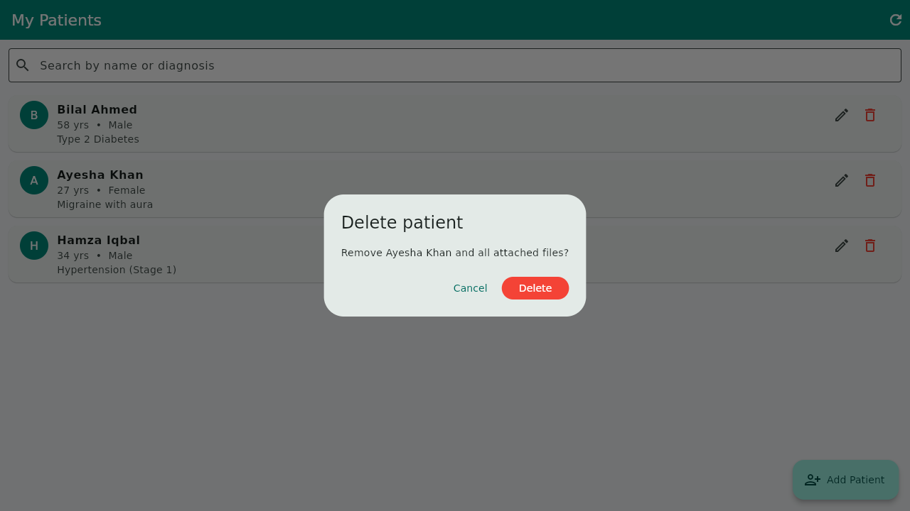

# Quiz 2 — Doctor App

**CSC303 – Mobile Application Development · Quiz No. 2 (CLO-2)**

A Flutter app that lets a doctor manage patient records offline. Patients are
stored in a local SQLite database, and reports or images can be attached to each
patient.

## Features

- **Patient management (CRUD)** — add, view, edit and delete patient records
- **Local database** — SQLite via `sqflite`, no internet required
- **File management** — attach documents and images to a patient, preview them,
  delete them; the picked file is copied into the app's own directory so the
  record keeps working if the original is moved
- **Search** — filter the patient list by name or diagnosis
- **Modern UI** — Material 3 with a teal clinical colour theme

## Project structure

```
lib/
  main.dart                          app entry point and theme
  models/patient.dart                patient model
  models/patient_file.dart           attached document / image model
  db/database_helper.dart            SQLite helper (tables + all CRUD queries)
  screens/patient_list_screen.dart   list, search, delete
  screens/patient_form_screen.dart   add / edit form with validation
  screens/patient_detail_screen.dart details + document management
test/widget_test.dart                widget test
screenshots/                         output of the running application
```

## Database

| Table | Columns |
|-------|---------|
| `patients` | id, name, age, gender, phone, diagnosis, notes, last_visit |
| `patient_files` | id, patient_id (FK, cascade delete), file_name, file_path, file_type, added_on |

Deleting a patient removes the attached file rows through the foreign key
cascade.

## Running it

```bash
flutter pub get
flutter run
```

On desktop the app switches `sqflite` to its FFI backend automatically; on
Android/iOS the default backend is used.

## Screenshots

### 1. Add a patient


### 2. Patient list


### 3. Patient details with attached documents


### 4. Viewing an attached report image


### 5. Edit a patient


### 6. Delete a patient

